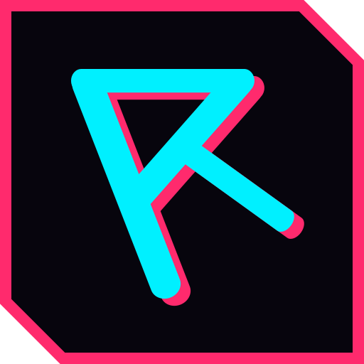

<p align="center">
  <a href="https://riagoncalves.dev/">
    
  </a>
</p>

<h1 align="center">riagoncalves.dev</h1>
<p align="center">
  My personal website: portfolio, experience, skills and blog, in English and Portuguese.
</p>

<p align="center">
  <a href="https://riagoncalves.dev/"></a>
  <a href="https://www.codefactor.io/repository/github/riagoncalves/riagoncalves.dev"></a>
</p>

## ✨ Features

- **Cyberpunk design**: neon palette, glitch effects and a perspective grid. Animations are turned off for visitors who prefer reduced motion.
- **English and Portuguese (pt-PT)**: English at `/`, Portuguese at `/pt`, with a language switcher.
- **Blog** managed with [Decap CMS](https://decapcms.org/). Posts can be written in either language and linked to their translation.
- **Discoverable by search engines and AI assistants**: sitemap with language alternates, structured data (JSON-LD), RSS feeds, `robots.txt`, and [`llms.txt`](https://llmstxt.org/) / `llms-full.txt` generated from the site data.
- **Fully static**: exported to plain HTML and hosted on Netlify, with Netlify Forms handling the contact form.

## 🧰 Tech stack

[Next.js 16](https://nextjs.org/) (App Router, static export) · [React 19](https://react.dev/) · [TypeScript](https://www.typescriptlang.org/) · [Tailwind CSS 4](https://tailwindcss.com/) · [Decap CMS](https://decapcms.org/) · [Netlify](https://www.netlify.com/)

## 🛠 Getting started

### Requirements

- Node.js 24 (see [`.nvmrc`](.nvmrc); Next.js needs at least 20.9)
- Yarn 4 (run `corepack enable` to get the version pinned in `package.json`)

### Setup

```bash
git clone https://github.com/riagoncalves/riagoncalves.dev.git
cd riagoncalves.dev
nvm use
yarn install
yarn dev
```

The site runs at http://localhost:3000, and the Portuguese version at http://localhost:3000/pt.

### Scripts

| Command | What it does |
| --- | --- |
| `yarn dev` | Starts the development server |
| `yarn build` | Builds the static site into `out/` |
| `yarn start` | Serves `out/` locally, the same way Netlify does |
| `yarn preview` | `build` and `start` in one step |
| `yarn lint` | Runs ESLint (`yarn lint:fix` to fix what it can) |
| `yarn deploy` | The build command Netlify runs |

## 📁 Project structure

```
content/posts/        Blog posts (Markdown with frontmatter)
public/admin/         Decap CMS (served at /admin)
src/app/              Routes: (en)/ for English, pt/ for Portuguese, plus sitemap, robots, llms.txt
src/components/       UI components; components/pages/ holds the pages shared by both languages
src/data/             Content as JSON: projects, experiences, skills, contacts, site settings
src/data/translations UI copy per language (en.json, pt.json)
src/types/            Shared TypeScript types
src/utils/            Helpers: i18n, posts, metadata, structured data, RSS, llms.txt
```

## ✏️ Editing content

- **Projects, experience, skills and contacts** live in `src/data/*.json`. Text that is shown in both languages is written as `{ "en": "…", "pt": "…" }`.
- **Interface copy** (navigation, headings, form labels) lives in `src/data/translations/en.json` and `pt.json`, which must have the same keys.
- **Site settings** (URL, name, social preview images, keywords) live in `src/data/site.json`.

### Blog posts

Write posts in the CMS at `/admin`, or add a Markdown file to `content/posts/`:

```markdown
---
title: My first post
lang: en                # en or pt
translation: o-meu-primeiro-artigo   # optional: slug of the same post in the other language
date: 2026-11-04
description: Shown in the blog list and as the page description.
draft: false
tags: [rails, react]
cover: /images/blog/cover.jpg        # optional
---

Post content in Markdown.
```

English posts are listed at `/blog` and Portuguese posts at `/pt/blog`. Setting `translation` on one of the two posts is enough: both link to each other, and the language switcher moves between them.

## 🚀 Deployment

The site deploys to Netlify. All settings are in [`netlify.toml`](netlify.toml):

- Build command: `yarn deploy`
- Publish directory: `out`
- Node.js 24

Pushing to `master` deploys to production, and every pull request gets a deploy preview.

## 📝 License

[MIT](LICENSE)
